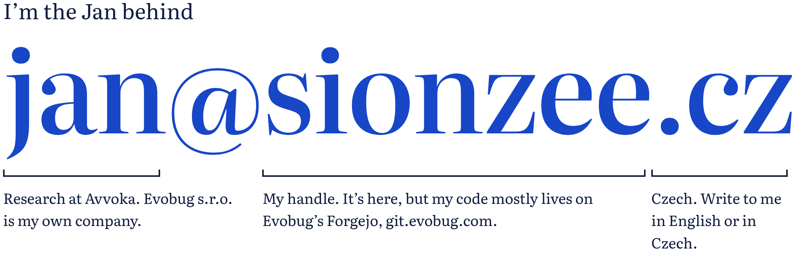

<a href="https://sionzee.cz">
  <picture>
    <source media="(prefers-color-scheme: dark)" srcset="assets/header-dark.png">
    
  </picture>
</a>

I work at [Avvoka](https://avvoka.com) in ART, the Avvoka Research Team. Before that I was Lead Software Engineer for the Editor and Plugin. I also run my own company, [Evobug s.r.o.](https://evobug.com), and look after [Allcom](https://allcom.zone), a Czech Discord community.

### Where my code is

Most of my work happens on Evobug’s Forgejo: **[git.evobug.com/sionzee](https://git.evobug.com/sionzee)**, with the company’s projects under **[git.evobug.com/evobug](https://git.evobug.com/evobug)**. I only use GitHub when a project has to be here, so a quiet graph on this page doesn’t mean a quiet year.

### What I build

| Project | What it is | Status |
| --- | --- | --- |
| [Mickle](https://evobug.games/mickle) | Private communication. A Rust desktop app on GPUI with no webview, end-to-end encrypted voice and video, self-hostable with federation. | In development |
| [TKit](https://evobug.games/tkit) | A Windows app that switches your Twitch stream category to match the active window. | Released, open source |
| [Allcom Bot](https://evobug.games/bot) | The modular Discord bot that runs Allcom: moderation, verification, virtual voice channels. | Released, MIT |
| [FingrlixPlus](https://evobug.games/fingrlixplus) | A Chrome extension that adds nutrition analytics to fingrlix.com. | Released |
| [Space Janitor](https://evobug.games/space-janitor) | A co-op game: keep a deep-space cargo hauler running while the crew sleeps. | In development |
| [EvoEngine](https://evobug.games/spacejanitorce) | Evobug’s own game engine and editor. C# on .NET 11, Vulkan, its own UI toolkit and shader pipeline. | In development |

The full catalogue is at [evobug.games](https://evobug.games).

### Reach me

Email is best: [jan@sionzee.cz](mailto:jan@sionzee.cz). I’m also `sionzee` on Discord, and the rest is at [sionzee.cz](https://sionzee.cz).
